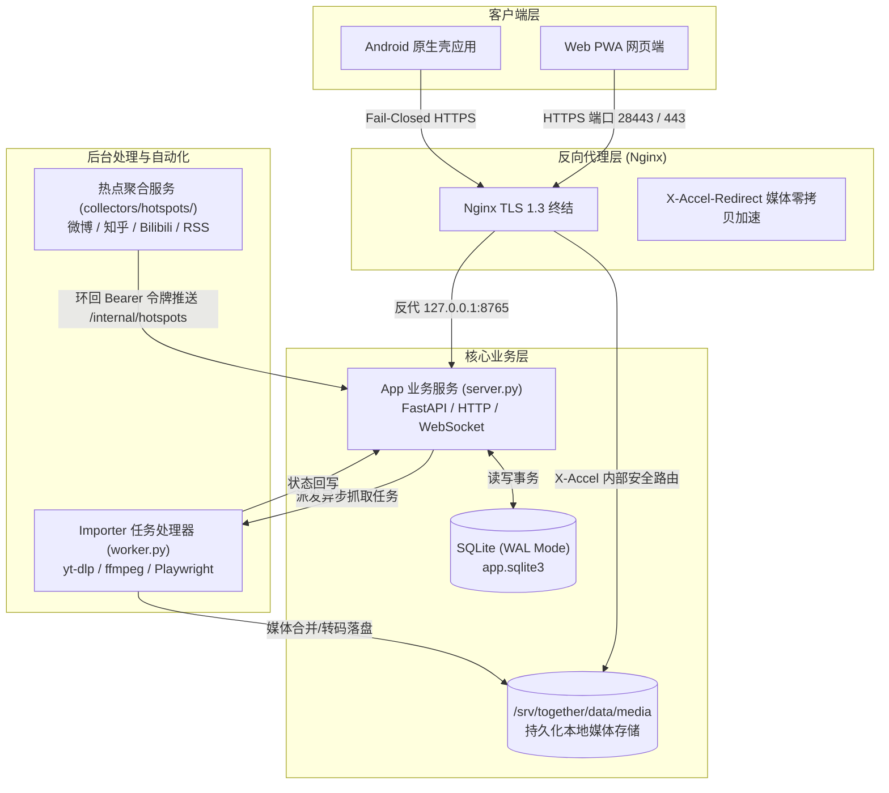

# 一起看 (Together / Just Between Us)

[](https://www.python.org/)
[](https://www.docker.com/)
[](https://developer.android.com/)
[](LICENSE)

> 一个专为情侣、密友或私密小群体设计的轻量级、自托管多媒体内容同步与热点聚合空间。

---

## 🌟 核心特性

- 📱 **双栏流式交互**：
  - **精彩分享（Manual Feed）**：双方手动提交的精彩内容、社交视频与图文笔记，支持置顶、搜索与未读标记。
  - **系统热点（System Hotspots）**：自动化采集主流平台（微博、知乎、Bilibili、少数派、RSS 等）的突发与热门资讯，具备严格配额与熔断机制。
- 🎬 **多平台媒体解析**：
  - **抖音 (Douyin)**：移动端真实播放页自适应解析，直连无水印高清 CDN 媒体流。
  - **TikTok**：Playwright 自动化回退与合规移动端提取。
  - **YouTube**：集成 yt-dlp 与 ffmpeg，支持 H.264 + AAC 自动合流重混、Shorts 短视频解析。
  - **Telegram**：支持公开频道帖文正文与多媒体资源提取。
  - **通用图文**：自适应 Readability 算法清洗，移除恶意外链脚本，提取首图与富文本。
- 📱 **原生 Android 壳应用**：
  - 超轻量 WebView 原生外壳（无需 Gradle，单 Python 脚本依赖官方 SDK 纯命令行编译）。
  - 系统级分享接收（`ACTION_SEND` 意图），手机任意 App 分享一键直达。
  - **安全闭环**：严格遵循 Fail-closed TLS 证书校验，禁用明文 HTTP 与不安全绕过。
- 🔒 **企业级安全与轻量架构**：
  - 单容器 Python 异步服务 + SQLite WAL 模式，轻量且支持高并发读。
  - Nginx `X-Accel-Redirect` 实现媒体资产鉴权与零拷贝极速分发。
  - 严格三层凭据隔离：用户密码、Worker 任务令牌、内部采集服务令牌（`HOTSPOT_SERVICE_TOKEN`）。
  - 零外部遥测，零第三方追踪 SDK。

---

## 🏗️ 系统架构



---

## 📂 目录结构

```text
together-app/
├── adapters/                  # 社交与流媒体平台适配器
│   ├── douyin/                # 抖音解析器 (SM3 签名算法、移动端解析)
│   ├── telegram/              # Telegram 公开频道解析器
│   ├── tiktok/                # TikTok 视频提取器
│   └── youtube/               # YouTube 音视频合流与 Shorts 适配器
├── android/                   # Android 原生外壳源码与免 Gradle 构建工具
│   ├── AndroidManifest.xml    # 声明安全网络配置与分享意图
│   ├── build_apk.py           # 原生 Python 极速打包签名脚本
│   ├── res/                   # 应用图标、网络安全配置、信任证书
│   └── src/                   # 原生 MainActivity (Fail-Closed TLS, JS Bridge)
├── client/                    # 纯原生 Web 前端 (Zero Dependencies)
│   ├── index.html             # 响应式双栏 DOM 结构
│   ├── app.js                 # 响应式状态管理、下拉刷新、艺术封面生成
│   ├── style.css              # 现代化自适应 UI 视觉系统
│   ├── video.css              # 深度定制视频播放器样式
│   └── *.svg                  # 应用图标与头像资源
├── collectors/                # 自动化热点采集子系统
│   └── hotspots/              # 多源热点调度器、状态机、环回传输驱动
├── config/                    # 生产与测试环境配置模板（严禁提交真实凭据）
│   ├── cn.env.template        # 业务服务端环境变量模板
│   ├── cn-worker.env.template # 任务处理 Worker 环境变量模板
│   └── hotspots.example.json  # 热点数据源矩阵配置示例
├── operations/                # 运维与自动化运维工具
│   ├── backup_sqlite.py       # SQLite WAL 热备份脚本
│   ├── verify_backup.py       # 备份数据完整性与事务校验
│   ├── deployment_preflight.py# 生产部署前置配置自检工具
│   └── systemd-templates/     # 生产环境服务单元模板
├── tests/                     # 覆盖全链路的自动化单元测试集 (230+ Tests)
├── Dockerfile                 # 主业务服务容器构建定义
├── Dockerfile.worker          # 媒体处理容器构建定义 (集成 Chromium & FFmpeg)
├── docker-compose.yml         # 标准 Docker Compose 单机编排
├── compose.cn.yml             # 国内镜像源优化版 Compose 编排
├── nginx.example.conf         # Nginx HTTPS + X-Accel 反代配置范例
└── requirements.txt           # Python 核心依赖清单
```

---

## 🚀 快速开始与部署

### 1. 部署前置环境
- **操作系统**：Linux (推荐 Ubuntu 20.04/22.04 LTS) / macOS / Windows (WSL2)
- **依赖软件**：
  - Docker 24.0+ 与 Docker Compose v2+
  - Python 3.10+
  - Nginx (用于反向代理与 TLS 证书终结)

### 2. 克隆仓库
```bash
git clone https://github.com/pipijun666/together-app.git
cd together-app
```

### 3. 配置环境变量
复制配置模板并生成高熵安全密钥：
```bash
cp config/cn.env.template .env
cp config/cn-worker.env.template .env.worker
```

编辑 `.env`（核心参数说明）：
```ini
HOST=0.0.0.0
PORT=8765
COOKIE_SECURE=1                # 生产环境强制开启 HTTPS Secure Cookie
NODE_ROLE=primary
MAX_MEDIA_BYTES=10737418240    # 媒体磁盘配额上限（默认 10GB，超额自动熔断）
MEDIA_X_ACCEL=1                # 启用 Nginx 媒体零拷贝加速

# 安全令牌（必须配置且长度 >= 32 字符的随机随机高熵值，两者必须不同）
WORKER_TOKEN=your_random_worker_token_32_chars_min
HOTSPOT_SERVICE_TOKEN=your_random_hotspot_token_32_chars_min

# 空间初始双方用户账号与口令（长度 >= 12 字符）
USER_ONE_NAME=ViewerOne
USER_ONE_PASSWORD=your_strong_password_one_123
USER_TWO_NAME=ViewerTwo
USER_TWO_PASSWORD=your_strong_password_two_456
```

编辑 `.env.worker`：
```ini
SERVER_URL=http://127.0.0.1:8765
WORKER_TOKEN=your_random_worker_token_32_chars_min  # 必须与 .env 中的 WORKER_TOKEN 完全一致
PROXY_URL=http://127.0.0.1:8118                   # 可选：海外内容解析代理出口（如 Clash/Mihomo）
VIDEO_OPTIMIZE=1                                  # 启用视频体积优化
VIDEO_MAX_HEIGHT=720                              # 最大转码分辨率
```

执行部署前安全自检：
```bash
python operations/deployment_preflight.py --role primary
```

### 4. 启动容器服务
```bash
# 启动主服务与解析 Worker
docker compose up -d --build

# 检查容器运行状态
docker compose ps
```

健康检查验证：
```bash
curl -f http://127.0.0.1:8765/healthz
# 正常返回: {"ok":true,"role":"primary","version":"0.5.0",...}
```

---

## 🌐 Nginx 反向代理配置

建议使用 Nginx 作为外部接入层，终结 HTTPS 流量并接管媒体文件的高性能分发。

在 `/etc/nginx/sites-available/together.conf` 中配置（可直接参考 [nginx.example.conf](nginx.example.conf)）：

```nginx
server {
    listen 80;
    server_name your-domain.com;
    return 301 https://$host$request_uri;
}

server {
    listen 443 ssl http2;
    # 若需避开国内未备案 443 端口检测，可使用自定义高端口（如 listen 28443 ssl http2;）
    server_name your-domain.com;

    ssl_certificate /etc/letsencrypt/live/your-domain.com/fullchain.pem;
    ssl_certificate_key /etc/letsencrypt/live/your-domain.com/privkey.pem;
    ssl_protocols TLSv1.2 TLSv1.3;
    ssl_ciphers HIGH:!aNULL:!MD5;

    client_max_body_size 64m;
    add_header Strict-Transport-Security "max-age=31536000; includeSubDomains" always;

    # 严禁公网访问内部管理和任务路由
    location ^~ /internal/ {
        return 404;
    }

    # 媒体文件鉴权安全加速（X-Accel-Redirect）
    location ^~ /__together_video/ {
        internal;
        alias /srv/together/data/media/;
        default_type video/mp4;
        sendfile on;
        tcp_nopush on;
        add_header Cache-Control "private, max-age=604800, immutable" always;
    }

    location ^~ /__together_image/ {
        internal;
        alias /srv/together/data/media/;
        default_type image/webp;
        sendfile on;
        add_header Cache-Control "private, max-age=604800, immutable" always;
    }

    # 业务主反代
    location / {
        proxy_pass http://127.0.0.1:8765;
        proxy_set_header Host $host;
        proxy_set_header X-Real-IP $remote_addr;
        proxy_set_header X-Forwarded-For $proxy_add_x_forwarded_for;
        proxy_set_header X-Forwarded-Proto $scheme;
        
        # 支持长连接与轮询
        proxy_read_timeout 120s;
        proxy_send_timeout 120s;
    }
}
```

测试配置并重载 Nginx：
```bash
sudo nginx -t && sudo systemctl reload nginx
```

---

## 📱 Android 客户端打包指南

本项目 Android 壳应用采用极简原生实现，**完全摆脱庞大的 Gradle 与第三方构建插件**。只需官方 Android SDK Build-Tools 与 JDK，即可单脚本在秒级完成编译、D8 字节码优化、资源对齐与 APK 签名。

### 构建步骤
```bash
python android/build_apk.py \
  --platform /path/to/android-sdk/platforms/android-35 \
  --tools /path/to/android-sdk/build-tools/34.0.0 \
  --java-bin /path/to/jdk-17/bin \
  --origin "https://your-domain.com:28443" \
  --out ./together-release.apk
```

**参数说明**：
- `--origin`：正式版绑定的服务端 HTTPS 根地址（自动注入 `BuildConfig.FIXED_ORIGIN`）。
- `--dev-local`：可选。构建开发调试包（开放手动输入地址窗口，允许 `127.0.0.1` 环回测试）。
- `--out`：指定生成的 APK 产物路径。

---

## 📰 自动化热点采集器配置

热点聚合模块独立运行于 `collectors/hotspots/`，支持定时采集各平台热榜并推送至独立「系统精选」栏目：

1. **配置文件**：参考 `config/hotspots.example.json` 配置启用的来源及频次限制。
2. **本地测试运行**：
   ```bash
   HOTSPOT_SYSTEM_API_BASE="http://127.0.0.1:8765" \
   HOTSPOT_SERVICE_TOKEN="your_random_hotspot_token_32_chars_min" \
   python -m collectors.hotspots --config config/hotspots.example.json --state-dir /srv/together/hotspots/state run
   ```
3. **生产定时任务**：使用 systemd timer 或 crontab 每 2 小时执行一次采集，完整模板见 `operations/systemd-templates/together-hotspots.timer.template`。

---

## 🧪 自动化测试验证

项目内置了严格覆盖所有关键路径的单元测试集（230+ 用例全部通过）：
```bash
# 运行全部测试集
python -m unittest discover -s tests -p "test_*.py"

# 单独验证核心系统契约
python -m unittest tests.test_system_core tests.test_tls_verification
```

---

## 🛡️ 安全承诺与设计原则

1. **Fail-Closed 契约**：移动端 WebView 遇到任何 TLS 异常或证书错误时，直接 `handler.cancel()` 强行阻断，严禁任何形式的跳过或静默放行。
2. **私有存储隔离**：媒体文件存储位于内部目录，外部请求必须先通过主应用 Session 鉴权，由后端签发内部重定向，防止媒体直链泄露。
3. **最小特权原则**：容器默认丢弃所有特权（`cap_drop: ALL`），以独立非 root 用户 `together` 运行；内部接口仅限 `127.0.0.1` 环回且携带专用 Token 访问。

---

## 📄 开源许可证

本项目采用 [MIT License](LICENSE) 开源协议。

